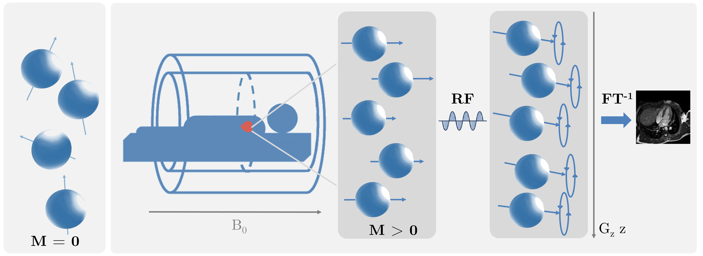

# Laboratorio de Imágenes - Magíster en Física Médica UC

Este repositorio contiene el material, guías de laboratorio e itinerario para las sesiones prácticas del curso de **Laboratorio de Imágenes**, dictado en el **Magíster en Física Médica de la Pontificia Universidad Católica de Chile (UC)**. El diseño curricular y el desarrollo de los entornos computacionales han sido creados por **Pamela Franco**.

El curso está orientado a estudiantes de posgrado en física médica y disciplinas afines, abordando el procesamiento, la reconstrucción, la caracterización microestructural y el análisis computacional de imágenes médicas (con énfasis en Resonancia Magnética) desde una perspectiva formal, física y cuantitativa en Python.

---

## Acceso Directo a los Laboratorios (Google Colab)

Haz clic en los botones de la tabla para abrir directamente los cuadernos interactivos en Google Colab:

| Clase / Laboratorio | Botón de Acceso |
| :--- | :--- |
| **Práctico 1:** Registro de Imágenes Médicas y Fusión Multimodal (`registration.ipynb`) | [](https://colab.research.google.com/github/pamelaFranco/Laboratorio-Imagenes/blob/main/codigos/registration.ipynb) |
| **Práctico 2:** Segmentación Anatómica y Funcional (`segmentation.ipynb`) | [](https://colab.research.google.com/github/pamelaFranco/Laboratorio-Imagenes/blob/main/codigos/segmentation.ipynb) |

---

## Estructura Teórica y Contenidos del Curso

El programa abarca segmentación y registro en MRI:


### 1. Registro de Imágenes Médicas y Fusión Multimodal
- Matrices de transformación espacial ($SFORM/QFORM$), coordenadas físicas y re-muestreo por interpolación.
- Evaluación de algoritmos de alineación rígidos, afines y difeomórficos no lineales (**SyN**).
- Corrección de distorsiones por susceptibilidad magnética (EPI) y fusión limpia T1 vs DTI (FA) para preservación anatómica.

### 2. Segmentación Anatómica y Funcional
- Algoritmos de umbralización adaptativa (Otsu) y filtrado morfológico.
- Transformada de Distancia Euclidiana (EDT) y segmentación por *Watershed*.
- Separación de estructuras vasculares y de tejidos blandos en imágenes médicas.

---

## Requisitos e Instalación Local

Para ejecutar los cuadernos de manera local en tu equipo, clona el repositorio e instala las dependencias necesarias:

```bash
git clone [https://github.com/pamelaFranco/Laboratorio-Imagenes.git](https://github.com/pamelaFranco/Laboratorio-Imagenes.git)
cd Laboratorio-Imagenes/codigos
pip install numpy scipy matplotlib opencv-python pydicom SimpleITK pyradiomics torch torchvision
```


> **Nota:** Para los cuadernos de DTI, Radiómica y Clasificación de Gliomas, se recomienda el uso de Google Colab con aceleración por GPU.
---

## License

[](https://opensource.org/licenses/MIT)
[](https://www.python.org/downloads/)